# Data Exchange app { #data_exchange }

## About the Data Exchange app { #about_data_exchange }

The Data Exchange app sends aggregate data from the DHIS2 instance where the app is installed to a target. The target can be another DHIS2 instance, other software that can import the DHIS2 data value set format, or the same instance. For example, you can aggregate tracker data and save the result as aggregate data in the same instance.

To send the data of a program indicator, first set up the program indicator in the Metadata Management app. For the steps, see [Transfer program indicator data with the Aggregate data exchange app](https://docs.dhis2.org/en/use/user-guides/dhis-core-version-master/configuring-the-system/metadata-management-app/program-disaggregations.html#mmp_program_disaggregation_exchange).

The app works with _aggregate data exchanges_. A data exchange defines the data elements, indicators, periods, and organisation units to send, and the target to send them to. You can create and manage exchanges in the app. For the details of how an exchange works, see the _Aggregate data exchange_ section in the _Data exchange_ chapter of the [Developer guide](https://docs.dhis2.org/en/develop/using-the-api/dhis-core-version-master/data-exchange.html).

The app shows only the exchanges that you have access to. If the app is not on your instance, ask an administrator to install it from the App Hub.

## Overview { #overview_data_exchange }

The Data Exchange app has the following sections:

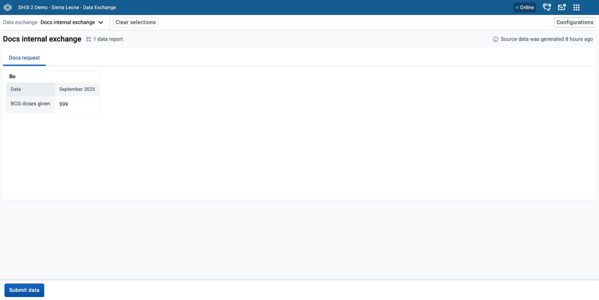

1. **Data exchange selection:** The **Data exchange** menu in the top bar lists the exchanges that you can see. Choose an exchange to open it.
2. **Clear selections:** Click **Clear selections** to close the exchange that you chose.
3. **Title bar:** The title bar shows the name of the exchange, the number of data reports in it, and how long ago DHIS2 generated the source data (the last successful analytics table update).
4. **Data reports:** Each request in the exchange is a data report. Each report has its own tab.
5. **Data preview:** The preview shows the data to send to the target. It has one table for each organisation unit, with one row for each data item and one column for each period. If the report links to a visualization, click **Open in data visualizer** to open it in a new tab.
6. **Submit data:** Click **Submit data** to send the data of the selected exchange.
7. **Configurations:** Click **Configurations** to create and manage exchanges. This button appears only if you have an exchange authority (see [Configure data exchanges](#configure_data_exchanges)).

## Exchange data { #exchanging_data }

To exchange data:

1. In the top bar, click **Data exchange** and choose an exchange.
2. Check the preview of each report to make sure that the data is correct and complete.
3. Click **Submit data**. A confirmation dialog opens.
4. Check the target, the organisation units, and the periods of each report, and click **Yes, submit**. DHIS2 sends the data and shows a submission summary.
5. Check the submission summary, and click **Close**.

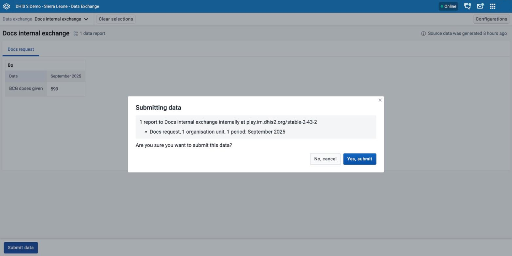

The **Submit data** button does not work in these cases:

-   The exchange has no data. The button is disabled, and a tooltip shows the message **There is no data to submit**.
-   You already submitted the exchange in this session. The button is disabled, and a tooltip shows the message **Data has already been submitted**.
-   You do not have data write access to the exchange. The button is disabled.

If you submit an internal exchange that skips audit information, you need the **Skip data import audit** authority. Without it, the confirmation dialog shows a warning, and DHIS2 ignores the data that you submit.

### Submission summary { #submission_summary }

The submission summary shows whether the submission succeeded, and how many data values DHIS2 imported, updated, and ignored. A table shows the same counts for each report.

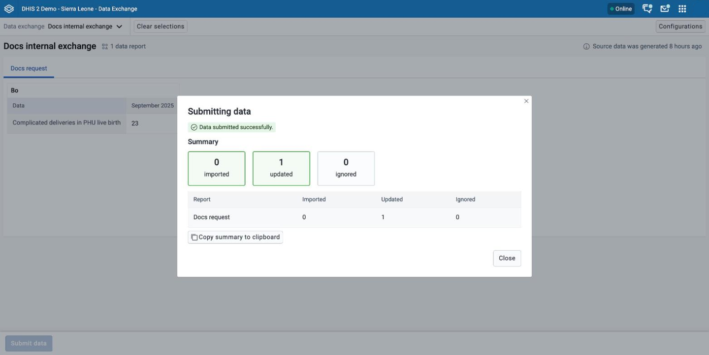

If the target reports conflicts, the summary shows the tag **Conflicts**. Expand the row of a report to see the conflicts. Each conflict lists an object and a value. To keep a record, click **Copy summary to clipboard**. The copied text contains the exchange name, the target URL for external exchanges, the run date, and the counts and conflicts of each report.

If the submission fails, the dialog shows the message **There was a problem submitting data** and the error from the server. Click **Try again** to submit again, or **Close** to leave the dialog.

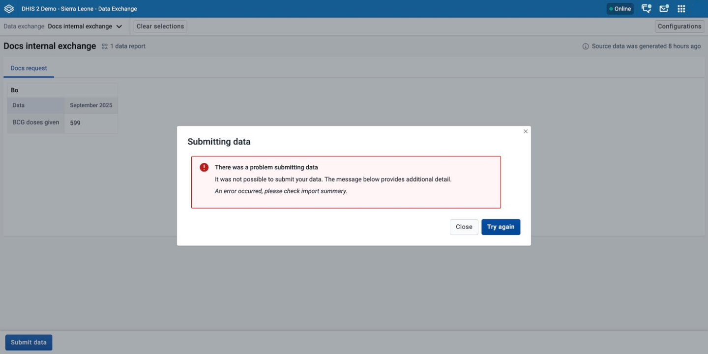

## Configure data exchanges { #configure_data_exchanges }

In configuration mode, you can create, edit, share, and delete data exchanges. To open it, click **Configurations** in the top bar of the app. To return to the data view, click **Exit configuration mode**.

The following authorities control what you can do:

| Authority                                                                                | What it allows                                                                                                                                         |
| ---------------------------------------------------------------------------------------- | ------------------------------------------------------------------------------------------------------------------------------------------------------ |
| Add/Update Private Aggregate Data Exchange, or Add/Update Public Aggregate Data Exchange | Create and edit exchanges, and share exchanges that you can edit. Shows **Configurations**, **New exchange configuration**, **Edit**, and **Sharing**. |
| Delete Aggregate Data Exchange                                                           | Delete exchanges. Shows **Configurations** and **Delete**.                                                                                             |

A user with the **ALL** authority has all of these actions.

The **Data Exchange Configurations** page lists the exchanges as cards. Each card shows the name, the target type (**External** or **Internal**), the number of requests, and the creation date. To find an exchange, type part of its name in **Search for an exchange**. Each card has the buttons **Edit**, **Delete**, and **Sharing**.

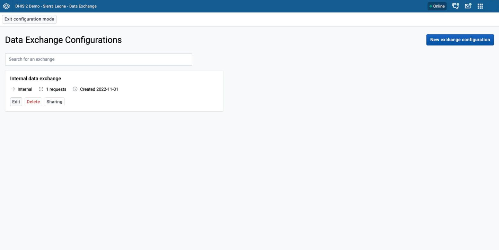

### Create a data exchange { #create_data_exchange }

1. On the **Data Exchange Configurations** page, click **New exchange configuration**.
2. In **Exchange name**, enter a unique name.
3. In **Exchange target type**, choose **External** to send data to another DHIS2 instance or a data warehouse. Choose **Internal** to manipulate data and transfer it inside this DHIS2 instance. **Internal** is the default.
4. For an external exchange, complete the **Target setup** section:
    1. In **Target URL**, enter the URL of the target instance or data warehouse.
    2. In **Authentication method**, choose **Basic** or **Personal Access token**.
    3. For **Basic**, enter the **Username** and **Password** of an account on the target. For **Personal Access token**, enter the **Access token** that you generated on the target instance.
5. In the **Requests** section, add one or more requests. See [Add a request](#add_request).
6. In the **Input ID scheme options** section, choose how the target identifies the data that it receives. See [ID schemes](#exchange_id_schemes).
7. Optional: Set the advanced options. See [Advanced options](#exchange_advanced_options).
8. Click **Save exchange**.

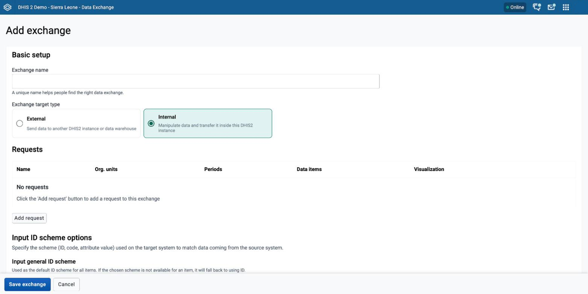

A new exchange appears in the data view only after someone has data access to it. See [Share a data exchange](#share_data_exchange).

If DHIS2 cannot save the exchange, the page shows the notice **Could not save** with the reason.

To leave the form without saving, click **Cancel**. If you changed anything, DHIS2 asks you to confirm that you want to discard the changes.

### Add a request { #add_request }

A request defines the data that an exchange sends. Each request becomes one data report in the data view.

1. In the **Requests** section, click **Add request**. The request form opens with a **Request setup** section.
2. In **Request name**, enter the name that the Data Exchange app shows for the report.
3. Optional: To filter the data, choose **Filter request**. A filter row appears. Choose a **Dimension** and its **Items**. Click **Add filter** to add more filters, or **Remove** to remove one.
4. Optional: To link the report to a visualization, choose **Link request to a visualization**. Click **Choose a visualization**, and choose a visualization from the list. The data view then shows the button **Open in data visualizer** for this report.
5. In the **Data items** section, choose the data elements, indicators, and other data items to send.
6. In the **Periods** section, choose the periods.
7. In the **Organisation units** section, choose the organisation units. You can choose organisation units from your own organisation unit hierarchy, and also organisation unit levels and groups.
8. In the **Output ID scheme options** section, choose how the exchange identifies the data items and organisation units that it sends. See [ID schemes](#exchange_id_schemes).
9. Click **Save request**.

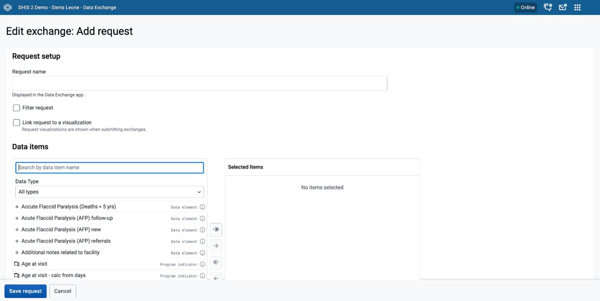

You must choose at least one data item, one period, and one organisation unit. Saving a request adds it to the exchange form only. DHIS2 stores the request when you click **Save exchange**.

To change a request, click its row in the **Requests** table. To remove a request, click **Delete** in its row.

#### v40 and earlier { #add_request_v40_and_earlier }

In v40 and earlier, the Data Exchange app has no **Output data item ID scheme** option in the **Output ID scheme options** section of a request.

In v40 and earlier, use **Output data element ID scheme** instead of **Output data item ID scheme** in the **Output ID scheme options** section of a request.

### ID schemes { #exchange_id_schemes }

An ID scheme tells DHIS2 which identifier to use for an object: **ID**, **Code**, or **Attribute**. To use **Attribute**, choose an attribute from the list that appears. If the app cannot find an attribute, the **Attribute** option is disabled.

In the request, the output ID schemes set the identifiers of the data that the exchange sends:

-   **Output general ID scheme:** The default scheme for all items. If the chosen scheme is not available for an item, DHIS2 uses the ID.
-   **Output data item ID scheme:** The scheme for data elements, indicators, and program indicators.
-   **Output data element ID scheme:** The scheme for data elements. It overrides **Output data item ID scheme** for data elements.
-   **Output organisation unit ID scheme:** The scheme for organisation units.

In the exchange, the input ID schemes set the identifiers that the target uses to match the data that it receives. The options are **Input general ID scheme** (default **ID**), **Input data element ID scheme**, **Input organisation unit ID scheme**, and **Input category option combo ID scheme**. For every scheme except the general scheme, choose the option that starts with **None** to follow the general scheme.

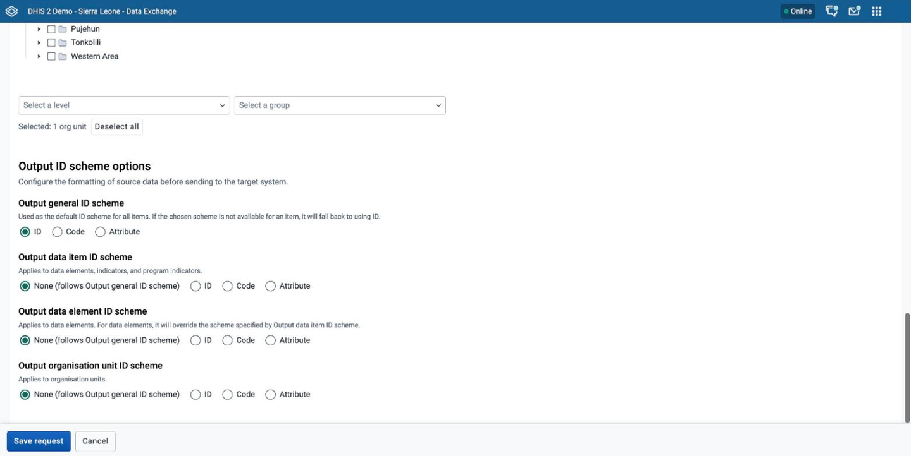

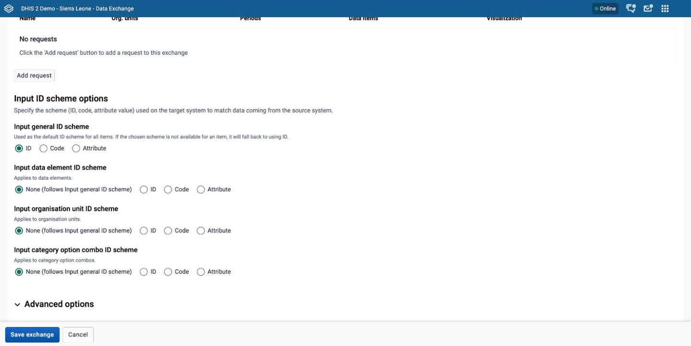

### Advanced options { #exchange_advanced_options }

Click **Advanced options** in the exchange form to change how the target imports the data:

-   **Skip audit, meaning audit values will not be generated:** Improves performance at the cost of the ability to audit changes.
-   **Dry run:** Tests the import settings without importing any data.
-   **Import strategy:** Choose one of the following:
    -   **Merge:** Import new values and update existing values. This is the default.
    -   **Append:** Import new values only.
    -   **Update:** Only update existing values, and ignore new values.
    -   **Delete:** Remove values that the exchange includes.

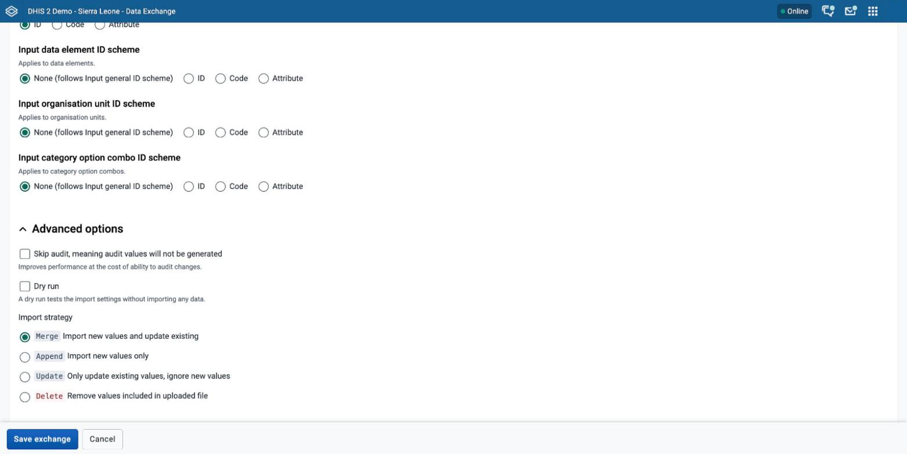

#### v40 and earlier { #exchange_advanced_options_v40_and_earlier }

In v40 and earlier, the exchange form of the Data Exchange app has no **Advanced options** section.

### Edit a data exchange { #edit_data_exchange }

1. On the **Data Exchange Configurations** page, click **Edit** on the card of the exchange.
2. Change the exchange, and click **Save exchange**.

For an external exchange, DHIS2 does not show the saved authentication details. To change the target URL or the authentication method, click **Edit authentication details**. You must then enter the password or access token again.

### Share a data exchange { #share_data_exchange }

Click **Sharing** on the card of the exchange to open the sharing settings. The sharing settings include data sharing, which controls who can see an exchange in the data view and who can submit its data. The **Sharing** button appears only if you can edit the exchange.

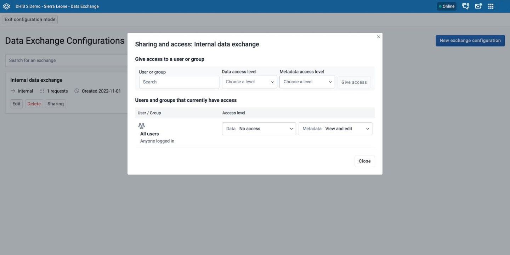

A new exchange gives no data access to other users. Even you cannot see it in the data view until you give data access. To do this, click **Sharing**. Search for a user or group, choose **View only** or **View and edit** as the **Data access level**, and click **Give access**. To change the access of a user or group that is already in the list, use the **Data** list in its row. A user needs **View and edit** data access to submit the exchange.

### Delete a data exchange { #delete_data_exchange }

1. On the **Data Exchange Configurations** page, click **Delete** on the card of the exchange.
2. Click **Yes, delete**.

Deleting an exchange removes it for all users of the instance. You cannot undo this action.
